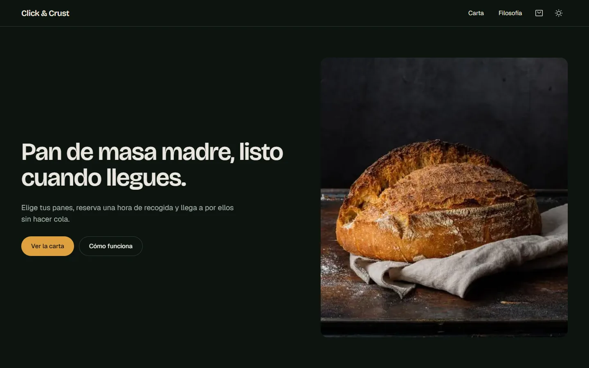
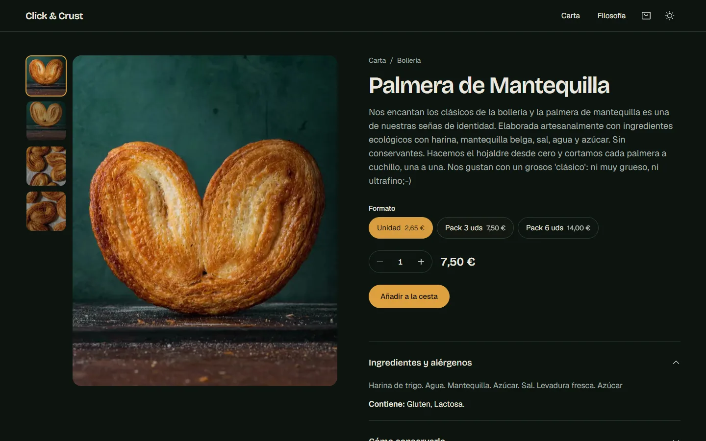
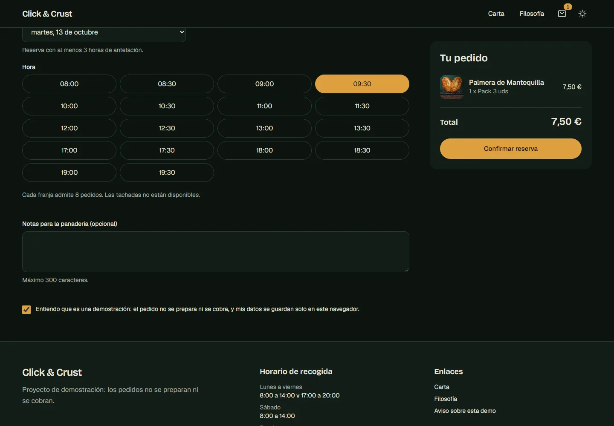
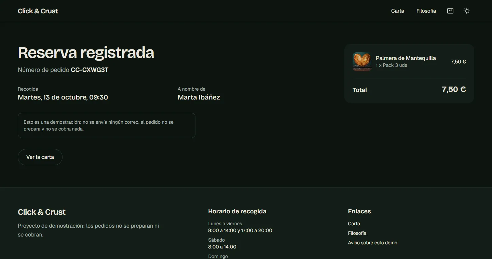
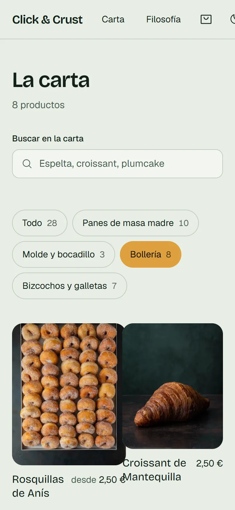

# Click & Crust

> Spanish version: [README.es.md](README.es.md)

A click-and-collect storefront for an artisan bakery: browse the menu, build a basket, and book a pickup slot. It is a **demonstration project, not a real business**. Orders are not prepared, paid or emailed.

**Live demo:** https://click-and-crust.vercel.app (a demonstration: orders are not prepared or paid). To run it locally, see [Run it](#run-it).

| Home | Product | Checkout |
|---|---|---|
|  |  |  |

| Confirmation | Menu on mobile, light theme |
|---|---|
|  |  |

## What it demonstrates

- **The server never trusts the client's prices.** The basket sends identifiers and quantities only. `POST /api/pedidos` rejects unknown fields (a `price` in the payload is a 400, not ignored), re-prices every line from the catalogue and fails the whole order if one line is invalid.
- **Pickup slots with real rules.** Opening hours per weekday, 30-minute slots, 3 hours of lead time, a 14-day horizon and 8 orders per slot, all evaluated in the bakery's timezone (`Europe/Madrid`), not the server's. Covered by tests around midnight and the October clock change.
- **State without effects.** The basket and the order receipts live in `localStorage`, validated with zod on read, and are exposed through `useSyncExternalStore`. No `useEffect` hydration, no flash of an empty basket, and corrupted storage falls back to empty instead of crashing.
- **Logic separated from UI.** Pure functions in `src/lib`, state in `src/hooks`, presentation in `src/components`. No component calls `fetch`; there is one API client.
- **Accessibility as a test, not a claim.** axe runs over 9 pages in both themes on desktop and mobile with WCAG 2.1 AA plus best-practice rules, and the suite fails on any violation.
- **Content as typed data.** 28 products live in `src/content`. A test checks every photo exists, slugs are unique, prices are positive integers, and related products point at real products (it caught two products recommending themselves).

## Quality

| What | How | Count |
|---|---|---|
| Unit and route tests | Vitest | 152 in 16 files |
| End-to-end, API contract, accessibility | Playwright + axe | 60 |
| Types | `tsc --noEmit`, `strict` + `noUncheckedIndexedAccess` | clean |
| Lint | ESLint 9, `next/core-web-vitals` | clean |

CI (`.github/workflows/ci.yml`) runs lint, typecheck, unit tests, build and the Playwright suite on every push and pull request.

### Measured performance

Lighthouse 12.8.2, mobile emulation with simulated throttling, production build served locally (`next start`, no CDN), median of 3 runs (5 for the menu), 2026-10-12.

| Page | Performance | Accessibility | Best practices | SEO | LCP | CLS | TBT |
|---|---|---|---|---|---|---|---|
| Home | 93 | 100 | 100 | 100 | 3.2 s | 0 | 53 ms |
| Menu | 92 | 100 | 100 | 100 | 3.3 s | 0 | 47 ms |
| Product | 93 | 100 | 100 | 100 | 3.3 s | 0 | 50 ms |

These are lab numbers on localhost. A deployed site behind a CDN will differ, and real-user data would say more than any of this.

## Architecture

```
src/
  app/          Routes only: pages, API route handlers, metadata
  components/   Presentation: props in, callbacks out (ui, layout, home, shop, cart, checkout)
  hooks/        State and effects: use-cart, use-checkout, use-pickup-slots...
  lib/          Pure logic: cart, pricing, slots, orders, schemas, stores. No React
  content/      Typed data: products, categories, hours, copy
e2e/            Playwright specs: shop flow, API contract, accessibility
scripts/        Image optimisation
```

## Decisions and trade-offs

| Decision | Choice | Trade-off |
|---|---|---|
| Money | Integer cents everywhere | Formatting happens only at the edge (`formatEuro`) |
| Category filter and search | URL is the state, filtering runs on the server | `/carta` is dynamic instead of static; works without JavaScript and is shareable |
| Basket persistence | `localStorage` + zod, no backend session | Basket does not follow the user across devices |
| Order storage | In-memory repository behind an `OrderRepository` interface | Orders vanish on restart; swapping in a database is one implementation |
| Rate limiting | Sliding window in memory, 6 orders per 10 min per IP | Per instance; a shared store is needed once there is more than one |
| Animation | Motion for scroll reveals only, CSS for the rest; entrance and scroll animations are off under `prefers-reduced-motion` | Less choreography, small bundle |
| Theme | One theme per page (dark by default, light on request or system preference) | Photos are dark, so dark is the primary design |

## Known limitations

- **Orders are not durable.** They live in server memory, and the confirmation page reads a receipt from the browser that placed the order.
- **The capacity check is not atomic.** Two simultaneous requests can both pass it. A real database needs a transaction in `OrderRepository.save`. This is documented in the interface.
- **No payments, emails or order management.** There is no bakery-side view of incoming orders.
- **No public holidays.** Opening hours are weekly only.
- **Spanish only**, and prices are in euros.
- **The client clock is trusted for the list of days only.** The server re-validates every slot with its own clock.

## Run it

```bash
pnpm install
cp .env.example .env.local   # optional: sets the public site URL for SEO tags
pnpm dev                     # http://localhost:3000
```

| Script | What it does |
|---|---|
| `pnpm lint` / `pnpm typecheck` | ESLint / TypeScript |
| `pnpm test` | Vitest unit and route tests |
| `pnpm build && pnpm test:e2e` | Production build, then Playwright (starts `next start` itself) |
| `pnpm images` | Converts originals in `images-src/` (not versioned) to WebP in `public/` |

Set `PW_CHROMIUM_PATH` to use an already installed Chromium for the E2E suite; otherwise run `pnpm exec playwright install chromium` once.

## About this repository

This is a from-scratch rewrite of an earlier prototype. None of the earlier code was kept; the product content and photographs were carried over and cleaned. The history here is the real build history.

## License

The code is MIT licensed (see [LICENSE](LICENSE)). The photographs and the product texts in `public/images` and `src/content/products.ts` are **not** covered by that license.
